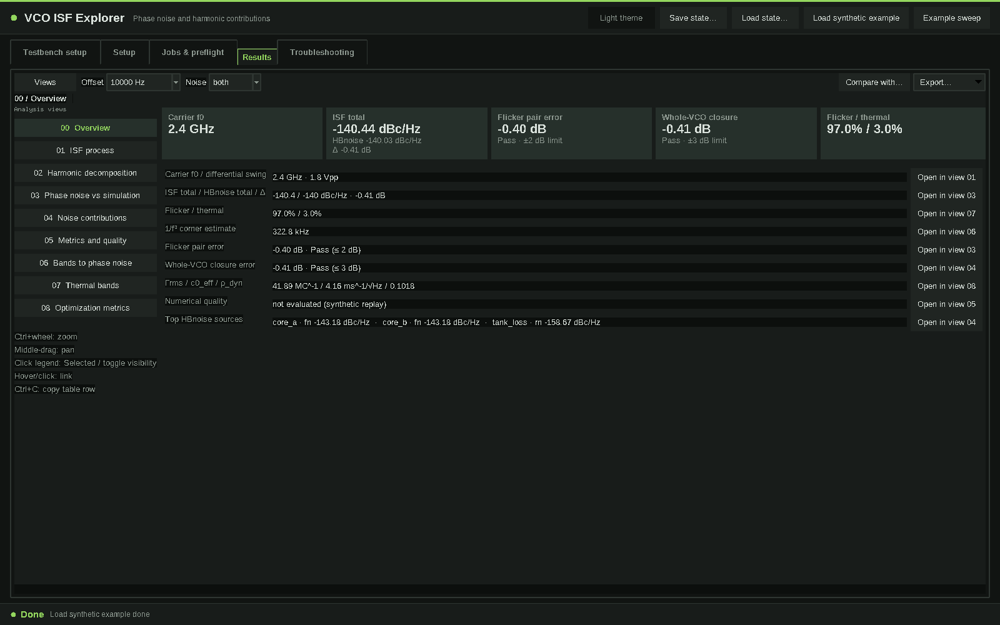

# VCO ISF Explorer

[简体中文](README.zh-CN.md)

VCO ISF Explorer analyzes how oscillator waveforms and selected noise sources contribute to phase noise using the impulse sensitivity function (ISF).



## What it does

- Prepare a testbench from a Design Lab project export, an existing Maestro setup with a new ISF test, or a new library cell.
- Select both devices for complementary or asymmetric cores and inspect per-device results. The symmetric shortcut requires measured half-period terminal agreement. Intrinsic drain-to-source flicker transfer uses both sidebands.
- Run and reopen durable jobs, inspect preflight errors, and preview storage estimates or archiving.
- Explore views 00–08 from waveform and harmonic decomposition through matched-source phase noise, thermal bands and optimization metrics. Compare matched results and export tables or plots.
- Replay the synthetic ideal-LC example offline in light or dark mode. Use the metrics API and CLI to inspect saved results and qualify comparisons.

## Requirements

Python 3.11 or newer. Tk is required for the desktop. NumPy is required for live analysis and optimization metrics, and Pillow enables PNG export. The synthetic replay and result viewing require no generator, Cadence installation, PDK or license.

Testbench entries A/B/C require the separate [VCO TB Generator](https://github.com/chloeyntu-byte/vco-tb-generator), your own Cadence Virtuoso/MAESTRO and Spectre tools and licenses, and the PDK and models for your circuit. Entry A also needs a Design Lab project export. The generator is published separately.

## Install and run the synthetic example

```sh
python3.11 -m venv .venv
. .venv/bin/activate
python -m pip install '.[analysis,images]'
vco-isf --workspace ./isf-workspace
```

Click **Load synthetic example** in the header. The result opens in **Results**. Pick an operating point and offset, then open an analysis view. The same bundle is available under [examples/ideal_lc](examples/ideal_lc). All its waveforms and source powers are generated from formulas. Use **Jobs & preflight** to reopen a replay already imported into this workspace.

[ISF process](docs/screenshots/01-process.png) · [harmonics](docs/screenshots/02-harmonics.png) · [source contributions](docs/screenshots/04-contributions.png) · [input bands](docs/screenshots/06-bands.png) · [optimization metrics](docs/screenshots/08-metrics.png) · [light theme](docs/screenshots/00-overview-light.png)

## Use with Cadence

Set `VCO_TBGEN_ROOT` to the generator checkout or pass `--tbgen-root` to a preparation or capabilities command. [Using VCO TB Generator](docs/TB_GENERATOR.md) covers installation, Cadence variables, what each entry asks the generator to do, and the writing rules. In [Testbench setup](docs/screenshots/testbench-setup.png), select:

- **A · Design Lab** for a generated project directory and exported DUT.
- **B · Existing Maestro** to review and add an ISF test to an existing setup. Explicitly confirm the new test. Use the current-session action when working from the matching Maestro window.
- **C · New cell** to supply the private library mapping, DUT, supplies, controls, models and output nets.

Confirm the target gm device. Under **Two-device analysis**, choose **Complementary core** or **Asymmetric pair** and select both occurrences. Use **Prepare** to review settings before **Start analysis**. To analyze a completed Maestro history without creating a test, use **Setup** or the [Maestro menu](docs/MAESTRO_PLUGIN.md). See the [integration API](docs/API.md), [bindings](docs/PORTABLE_BINDING.md) and [HB analysis bundle](docs/HB_ANALYSIS_BUNDLE.md).

## CLI and API

```sh
vco-isf --help
vco-isf capabilities --tbgen-root /path/to/vco-tb-generator --json
vco-isf --diagnose --workspace ./isf-workspace --json
vco-isf metrics --workspace ./isf-workspace --job JOB_ID --point lc_ideal --offset-hz 10000 --json
vco-isf metrics compare before.json after.json --point lc_ideal --offset-hz 10000 --json
vco-isf optim evaluate result.json --level L2 --point lc_ideal --offset-hz 10000
vco-isf optim gate metrics.json
vco-isf optim calibrate selected-result-ref.json
```

Use a completed job or exported result for metrics, and a result with the required closure and acquisition evidence for optimizer qualification. `vco-isf --web` opens the local browser interface for the Maestro-pair workflow. See [metrics](docs/ISF_METRICS.md) and [optimizer inputs](docs/OPTIM_API.md).

## Limitations

- Native compatibility was checked on one Virtuoso IC6.1.8 / Spectre 18.1 installation and a few CMOS processes. Qualify your toolchain, bindings and source evidence before relying on a result.
- The modeled scope covers flicker and thermal noise of the selected gm devices and thermal noise from supported passive LC loss. Whole-oscillator HBnoise can include other sources. Unavailable mechanisms are reported as N/A.
- Compare matching devices, mechanisms, operating points and offsets. The optimizer gate uses absolute flicker error below 0.5 dB for a symmetric pair, or at most 2 dB per device and mechanism for a manually selected pair. It also checks total closure and numerical quality.
- ISF verifies and explains simulated changes. A baseline ISF cannot predict the direction of a tuning change. Use HBnoise to qualify phase noise. [Theory and validation](docs/ISF_THEORY.md)

## Not included in this repository

- Your PDK, model files, device names or corners. [configs](configs) contains fictional examples.
- Your Cadence Virtuoso, Maestro and Spectre tools or licenses.
- A PSS/PNOISE adapter. The bundled runner uses HB, HBNOISE and HBXF.
- Measured results from any real process. The example is synthetic ideal LC.

For release checks, see [CONTRIBUTING.md](CONTRIBUTING.md).

## RF-FIELDWORK

- Lab home (all tools, narrated films and progress): https://rf-fieldwork.pages.dev/?lang=en
- This tool's page (with a narrated film): https://rf-fieldwork.pages.dev/isf/?lang=en

Other open-source tools:

- [Flux Studio](https://github.com/chloeyntu-byte/flux-studio): parametric RF passives, EMX sweeps, multi-objective search and SNPFit
- [Tank Scan Lab](https://github.com/chloeyntu-byte/tank-scan-lab): LC tank scans (f0, Rp, gm, startup margin, loss shares), capacitor-array C/Q and resonance
- [Layout 3D Viewer](https://github.com/chloeyntu-byte/layout-3d-viewer): read IC layouts in 3D, locate pins and trace connections
- [VCO Design Studio](https://github.com/chloeyntu-byte/vco-design-studio): five literature LC VCO topology families, packaged schematics and native export
- [VCO TB Generator](https://github.com/chloeyntu-byte/vco-tb-generator): Virtuoso testbench and Maestro HB/HBNOISE/HBXF setup for LC VCOs; required by testbench entries A/B/C


## License

MIT. See [LICENSE](LICENSE).
