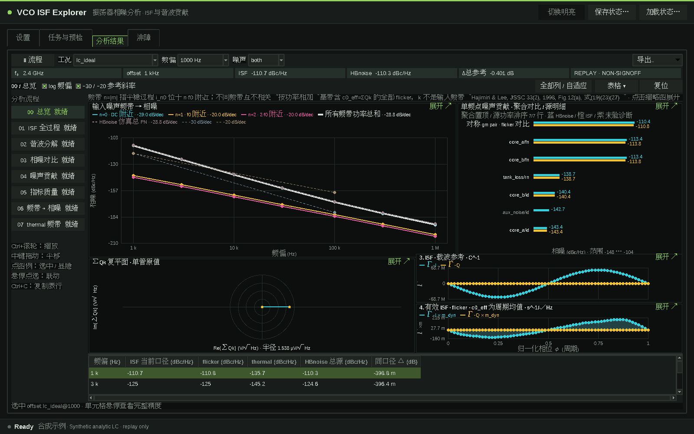
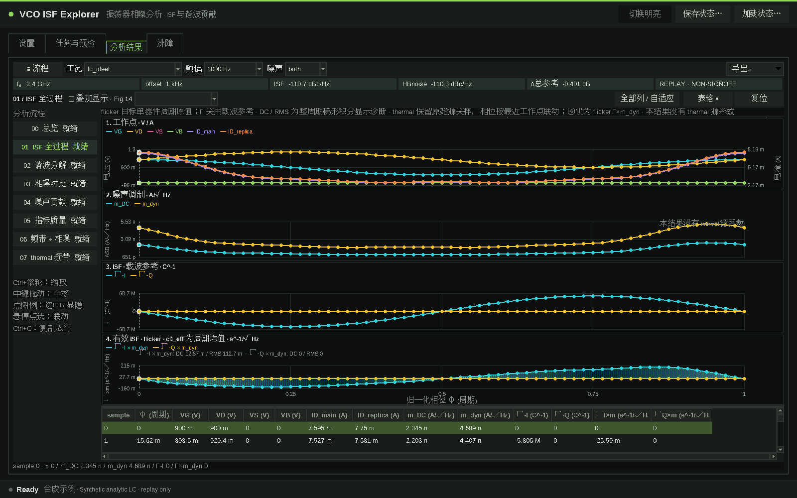
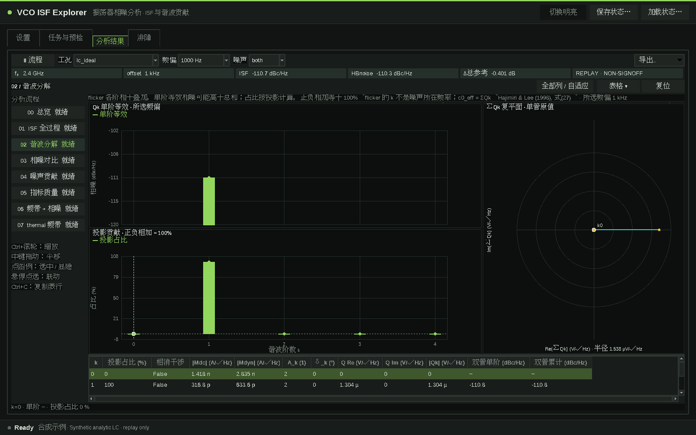
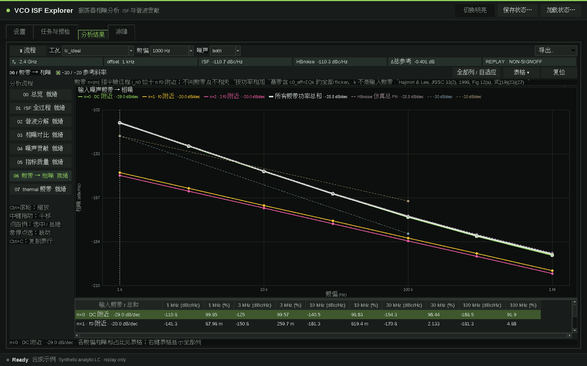
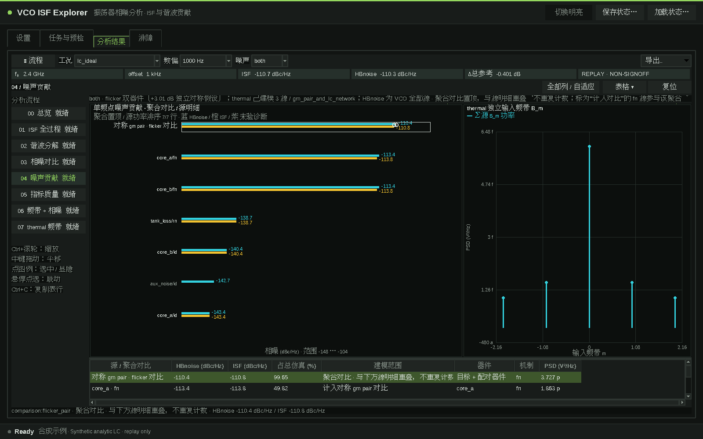

# VCO ISF Explorer

[中文说明](README.zh-CN.md)

Desktop analysis procedure for LC-VCO impulse sensitivity function (ISF / PPV) and flicker-noise up-conversion analysis, with a dark instrument-style Tk interface.




Version 1.1.0 adds eight result views (00–07), a linked table drawer, the ISF process and Fig.14 overlay, signed Qk projection fractions, input-band phase noise with slopes, and per-source thermal bands. Source details rank by reference power; the flicker pair comparison remains an aggregate, never counted twice. The analytic example includes thermal and an unmodeled source; thermal scope is the gm pair and passive LC.

## What it does

- **Flicker-noise up-conversion** from a completed VCO HB/HBNOISE Maestro history and one selected core MOS: the tool builds a private flicker fixture and reports the single-device result plus a symmetric independent two-device estimate (+3.01 dB).
- **ISF and harmonic closure**: carrier-referenced signed-H ISF branches (I/Q), per-harmonic contributions, and complex cumulative sums (ISF process and harmonic decomposition views).
- **Phase-noise views**: linked phase-noise and same-scope error plots over offset, source-contribution bars on a common PSD scale, zoom/pan/hide, and EPS export.
- **Thermal branch** for the manual noise-testbench analysis procedure (gm pair plus supported native LC loss sources); see [docs/THERMAL_NOISE.md](docs/THERMAL_NOISE.md).
- **Offline replay**: import canonical CSV bundles ([formats/README.md](formats/README.md)) without any EDA tool. A synthetic ideal-LC example ships in [examples/ideal_lc](examples/ideal_lc).
- **Maestro menu launcher** and a read-only environment report (`--diagnose`).

The UI text is Chinese; the code, documentation and data formats are English/bilingual.

## Requirements

- Python 3.11 or newer with Tk 8.6 (`tkinter`).
- NumPy for live extraction (`pip install '.[live]'`); not needed to view the example.
- **Optional, supplied by you:** a licensed Cadence Virtuoso/Maestro/Spectre environment and your own PDK. Nothing in this repository contains a PDK, model file, license information or simulator result. Features that run simulations or read Maestro histories need that environment; viewing results from the example bundle does not.

## Install / Quick start

```bash
git clone <repository-url> vco-isf-explorer
cd vco-isf-explorer
python3.11 -m pip install -e '.[live]'      # or run from the source tree
python3.11 run.py --workspace ./work
```

1. On the first page click **载入示例** (Load example). The bundled synthetic ideal-LC replay (three operating points x seven offsets) is imported and the **分析结果** page opens.
2. Browse phase noise vs offset, the contribution tables, harmonics, and the ISF waveform. The ideal-LC ISF is a pure sine; the two "asym" points add second-harmonic content.
3. Regenerate the example data at any time:

```bash
python3.11 examples/generate_example.py examples/ideal_lc
```

The example is analytic (ideal parallel LC, sinusoidal carrier, white + 1/f current-noise source with a fictional 200 kHz corner) and the "reference" phase noise is the model prediction shifted by a fixed dB offset. It is for exploring the UI, not a measurement.

On a headless host provide X11/VNC for Tk. An optional loopback-only Web UI is available with `python3.11 run.py --web --workspace ./work --open`.

## Using with Cadence

From a Maestro window use **Plug-in → Open VCO ISF Explorer**, choose a completed VCO history, the core MOS and the frequency offsets, then **开始分析**. Setup is described in [docs/MAESTRO_PLUGIN.md](docs/MAESTRO_PLUGIN.md); in short:

- load `cadence/vco_isf_menu.il` from your `.cdsinit` after pointing it at your checkout (`export VCO_ISF_HOME=/path/to/vco-isf-explorer`, or set `isfMaestroLauncher` before loading);
- the launcher looks for Python 3.11+ with Tk; set `VCO_ISF_PYTHON` to pick one explicitly;
- PDK location, device names, corners and tool paths are **your configuration**: the tool detects names from the selected history and lets you override them under **高级设置**. `configs/` only contains fictional generic examples (`PDK_A`, `device_model.scs`, `generic_nmos`); see [configs/README.md](configs/README.md).

## CLI for agents

```bash
python3.11 run.py --diagnose --workspace ./work --json     # read-only environment report (JSON)
python3.11 run.py --workspace ./work                        # desktop UI
python3.11 run.py --web --host 127.0.0.1 --port 8765        # optional loopback Web UI
```

`--diagnose` also accepts `--config FILE` and `--maestro-context-file FILE`; its exit status is 0 when the environment is ready and 1 otherwise. Installed wheels expose the same entry points as `vco-isf`, `vco-isf-web`.

## Limitations

- Testing never grants numerical signoff for a given PDK or design; imported data is always replay/non-signoff.
- Topology detection needs a readable generated netlist in the selected history; schematic OA is not decoded.
- The bundled runner executes the HB/HBNOISE path; PSS/PNOISE needs a separately verified adapter.
- Thermal prediction covers MOS BSIM3v3/BSIM4 `id/rd/rs` and supported native passive loss mechanisms only; other devices show N/A, never a filled-in zero.
- There is no safe generic Cadence cancel API: closing the window does not stop a simulator job.
- No DRC/LVS or layout functionality.

More detail: [docs/ARCHITECTURE.md](docs/ARCHITECTURE.md), [docs/PORTABLE_BINDING.md](docs/PORTABLE_BINDING.md), [SECURITY.md](SECURITY.md).

## Offline checks

```bash
python3.11 -m unittest discover -s tests
ISF_GUI_TEST=1 python3.11 -m unittest discover -s tests   # also runs the GUI tests (needs a display)
```

## RF-FIELDWORK

Product page: https://rf-fieldwork.pages.dev/isf/?lang=en

Other open-source tools:

- [Flux Studio](https://github.com/chloeyntu-byte/flux-studio): parametric RF passives, EMX sweeps, multi-objective search and SNPFit
- [Cap Array Lab](https://github.com/chloeyntu-byte/cap-array-lab): capacitor-array C/Q, parasitic paths, resonance and Z11
- [Layout 3D Viewer](https://github.com/chloeyntu-byte/layout-3d-viewer): read IC layouts in 3D, locate pins and trace connections
- [Crescendo](https://github.com/chloeyntu-byte/crescendo): automatic device-size optimization inside Cadence Maestro
- [VCO Design Studio](https://github.com/chloeyntu-byte/vco-design-studio): five literature LC VCO topology families, packaged schematics and native export

## License

MIT, see [LICENSE](LICENSE).

Theory and synthetic examples: [ISF theory](docs/ISF_THEORY.md), [input bands](docs/input-noise-bands.md).








