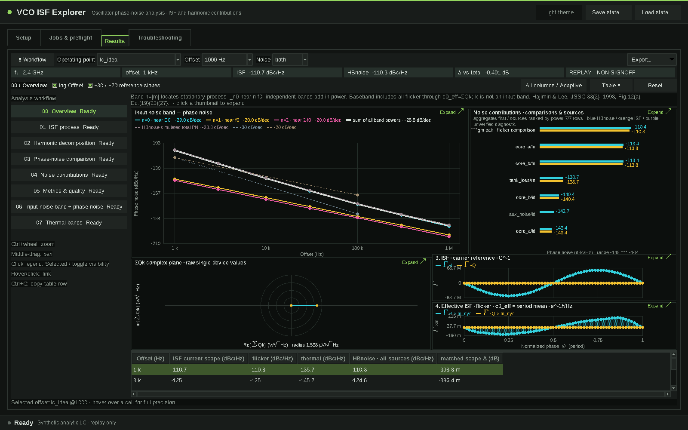
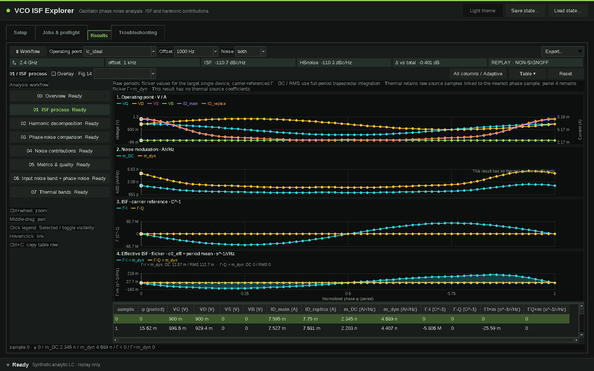
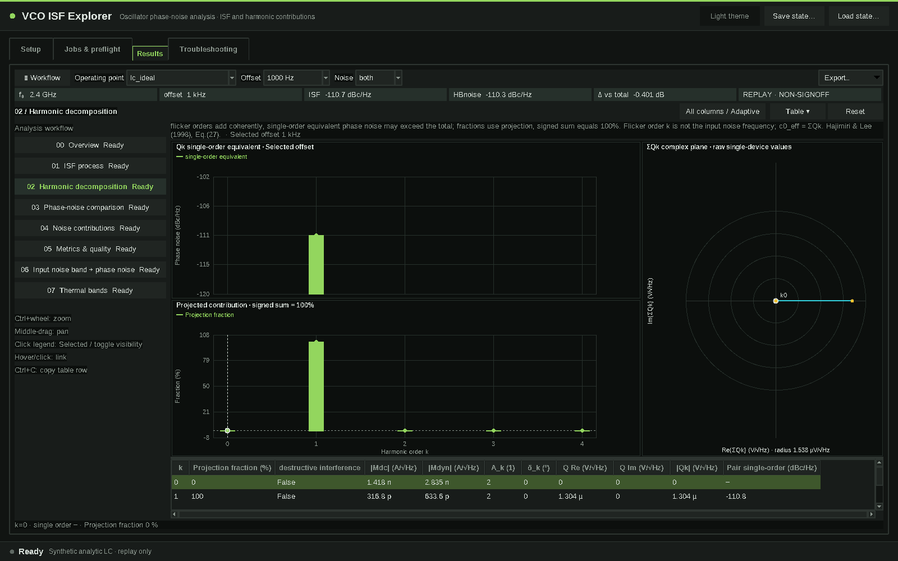
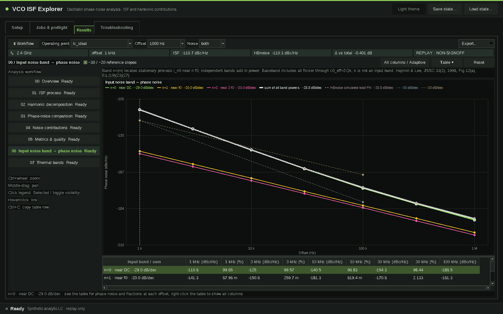
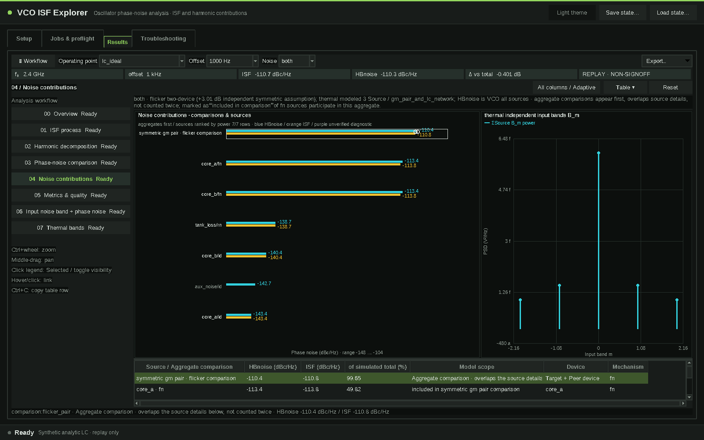

# VCO ISF Explorer

[English](README.md)

LC VCO 冲激敏感函数（ISF / PPV）与闪烁噪声上变频的桌面分析工作流，界面为深色仪器风格的 Tk 窗口。




1.1.0：结果页提供 00–07 流程导航、表格抽屉与图表双向联动；新增 ISF process 与 Fig.14 叠加、Qk 投影占比、输入频带相噪及斜率、逐源 Thermal bands。Noise contributions 恢复 pair 对比，并按参考功率排序。示例含合成 thermal 与未建模源；thermal 计算范围为 gm 对管与无源 LC。

## 功能

- **闪烁噪声上变频**：从已完成的 VCO HB/HBNOISE Maestro history 和选定的一颗核心 MOS 生成私有闪烁夹具，给出单管结果和对称独立双管估算（+3.01 dB）。
- **ISF 与谐波闭合**：以载波为参考的带符号 H（I/Q）ISF 分支、逐阶谐波贡献和复数累计（“ISF process”和“Harmonic decomposition”视图）。
- **相噪视图**：相噪与同口径误差随频偏联动，源贡献横条使用统一 PSD 分母，支持缩放、平移、显隐和 EPS 导出。
- **热噪声支路**（手工噪声 TB 工作流）：gm 对管加受支持的原生 LC 损耗源，见 [docs/THERMAL_NOISE.md](docs/THERMAL_NOISE.md)。
- **离线回放**：导入 canonical CSV bundle（[formats/README.md](formats/README.md)），无需任何 EDA 工具；仓库自带合成 ideal-LC 示例 [examples/ideal_lc](examples/ideal_lc)。
- **Maestro 菜单启动器**与只读环境检测（`--diagnose`）。

桌面和 Web 界面均为英文；数据格式与导出字段名保持不变。

## 环境要求

- Python 3.11 及以上，带 Tk 8.6（`tkinter`）。
- 实际提取需要 NumPy（`pip install '.[live]'`）；查看示例不需要。
- **可选，由你自行提供：** 有授权的 Cadence Virtuoso/Maestro/Spectre 环境和你自己的 PDK。本仓库不含 PDK、模型文件、license 信息或仿真结果。运行仿真、读取 Maestro history 的功能需要该环境；查看示例 bundle 不需要。

## 安装与快速开始

```bash
git clone <repository-url> vco-isf-explorer
cd vco-isf-explorer
python3.11 -m pip install -e '.[live]'      # 也可直接在源码目录运行
python3.11 run.py --workspace ./work
```

1. 在第一页点击 **Load example**。自带的合成 ideal-LC 回放（3 个工况 × 7 个频偏）会被导入，并自动切到 **Results** 页。
2. 查看相噪随频偏曲线、贡献表、谐波和 ISF 波形。理想 LC 的 ISF 是纯正弦；两个 “asym” 工况加入了二次谐波成分。
3. 随时可以重新生成示例数据：

```bash
python3.11 examples/generate_example.py examples/ideal_lc
```

示例是解析模型（理想并联 LC、正弦载波、白噪声 + 1/f 电流噪声源，虚构的 200 kHz 拐角），“参考”相噪是模型预测值加固定 dB 偏移。它用于熟悉界面，不是实测数据。

无显示的主机需要提供 X11/VNC。可选的仅本机回环 Web 界面：`python3.11 run.py --web --workspace ./work --open`。

## 在 Cadence 中使用

在 Maestro 窗口选择 **Plug-in → Open VCO ISF Explorer**，选择已完成的 VCO history、核心 MOS 和频偏，然后点击 **Start analysis**。详见 [docs/MAESTRO_PLUGIN.md](docs/MAESTRO_PLUGIN.md)，要点：

- 在 `.cdsinit` 中加载 `cadence/vco_isf_menu.il`，先指向你的检出目录（`export VCO_ISF_HOME=/path/to/vco-isf-explorer`，或在加载前设置 `isfMaestroLauncher`）；
- 启动器会查找带 Tk 的 Python 3.11+，也可用 `VCO_ISF_PYTHON` 明确指定；
- PDK 位置、器件名、工艺角和工具路径都是**你的配置**：工具从所选 history 检测名称，并允许在 **Advanced settings** 中覆盖。`configs/` 只含虚构的通用示例（`PDK_A`、`device_model.scs`、`generic_nmos`），见 [configs/README.md](configs/README.md)。

## 命令行（供 agent 使用）

```bash
python3.11 run.py --diagnose --workspace ./work --json     # 只读环境报告（JSON）
python3.11 run.py --workspace ./work                        # 桌面界面
python3.11 run.py --web --host 127.0.0.1 --port 8765        # 可选的本机回环 Web 界面
```

`--diagnose` 还接受 `--config FILE` 和 `--maestro-context-file FILE`；环境就绪时退出码为 0，否则为 1。安装 wheel 后提供同样的入口 `vco-isf`、`vco-isf-web`。

## 限制

- 测试通过不等于任何 PDK 或设计的数值签核；导入的数据一律为 replay / 非签核。
- 拓扑识别需要所选 history 中可读的生成网表；不解码 schematic OA。
- 自带运行器执行 HB/HBNOISE 路径；PSS/PNOISE 需要另行验证的适配器。
- 热噪声预测只覆盖 MOS BSIM3v3/BSIM4 的 `id/rd/rs` 与受支持的原生无源损耗机制；其他器件显示 N/A，不用零补齐。
- Cadence 没有安全的通用取消接口：关闭窗口不会停止仿真任务。
- 不含 DRC/LVS 或版图功能。

更多说明：[docs/ARCHITECTURE.md](docs/ARCHITECTURE.md)、[docs/PORTABLE_BINDING.md](docs/PORTABLE_BINDING.md)、[SECURITY.md](SECURITY.md)。

## 离线检查

```bash
python3.11 -m unittest discover -s tests
ISF_GUI_TEST=1 python3.11 -m unittest discover -s tests   # 同时运行 GUI 测试（需要显示）
```

## RF-FIELDWORK

产品介绍页：https://rf-fieldwork.pages.dev/isf/?lang=zh（含配音演示片的工具在页面上可直接观看）

其他开源工具：

- [Flux Studio](https://github.com/chloeyntu-byte/flux-studio)：参数化射频无源器件、EMX 扫参、多目标优化与 SNPFit 拟合
- [Cap Array Lab](https://github.com/chloeyntu-byte/cap-array-lab)：电容阵列 C/Q、寄生路径、谐振与 Z11
- [Layout 3D Viewer](https://github.com/chloeyntu-byte/layout-3d-viewer)：三维阅读版图、定位 pin、追踪连接
- [Crescendo](https://github.com/chloeyntu-byte/crescendo)：在 Cadence Maestro 里自动优化器件尺寸
- [VCO Design Studio](https://github.com/chloeyntu-byte/vco-design-studio)：五类文献 LC VCO 拓扑、分层原理图与原生导出

## 许可

MIT，见 [LICENSE](LICENSE)。

理论与示例: [ISF theory](docs/ISF_THEORY.md), [input bands](docs/input-noise-bands.md).








