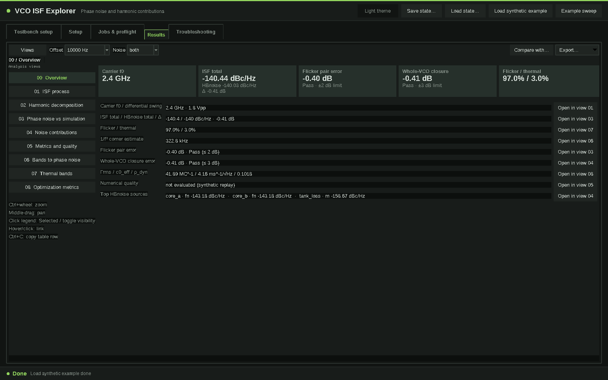

# VCO ISF Explorer

[English](README.md)

VCO ISF Explorer 使用脉冲灵敏度函数（ISF）分析振荡器波形和所选噪声源对相位噪声的贡献。



## 功能

- 从 Design Lab 项目导出、现有 Maestro 配置或新库单元准备台架。现有 Maestro 可在审核后新增 ISF 测试。
- 手动选择互补核心或不对称对管中的两个器件，并查看逐器件结果。对称简化需通过端子波形的半周期实测校验。本征漏源闪烁传递采用上下两个边带。
- 运行和重开持久化作业，查看预检错误、空间估算和归档预览。
- 在 00–08 视图中检查波形、谐波、同源相噪、热噪声频带和优化指标。可对照匹配结果并导出表格或图。
- 用浅色或深色主题离线回放理想 LC 合成示例，也可通过 API 和命令行读取指标并校验比较条件。

## 环境要求

Python 3.11 或更新版本。桌面需要 Tk，实时分析和优化指标需要 NumPy，导出 PNG 需要 Pillow。合成回放和查看结果无需台架生成器、Cadence、PDK 或许可证。

台架入口 A/B/C 需要独立发布的 [VCO TB Generator](https://github.com/chloeyntu-byte/vco-tb-generator)、用户自己的 Cadence Virtuoso/MAESTRO、Spectre 与许可证，以及电路所用的 PDK 和模型。入口 A 还需要 Design Lab 项目导出。

## 安装并运行合成示例

```sh
python3.11 -m venv .venv
. .venv/bin/activate
python -m pip install '.[analysis,images]'
vco-isf --workspace ./isf-workspace
```

点击顶栏的 **Load synthetic example**，在 **Results** 中选择工况、频偏和视图。同一数据包位于 [examples/ideal_lc](examples/ideal_lc)，其中的波形和噪声功率均由公式生成。已导入的回放可从 **Jobs & preflight** 重新打开。

[ISF 过程](docs/screenshots/01-process.png) · [谐波](docs/screenshots/02-harmonics.png) · [噪声贡献](docs/screenshots/04-contributions.png) · [输入频带](docs/screenshots/06-bands.png) · [优化指标](docs/screenshots/08-metrics.png) · [浅色主题](docs/screenshots/00-overview-light.png)

## 在 Cadence 中使用

将 `VCO_TBGEN_ROOT` 设为生成器仓库路径，或在支持的命令上指定 `--tbgen-root`。安装方式、Cadence 环境变量、各入口调用生成器的哪些功能以及写入规则见 [Using VCO TB Generator](docs/TB_GENERATOR.md)（英文）。在 [Testbench setup](docs/screenshots/testbench-setup.png) 中选择入口。

- **A · Design Lab** 选择生成目录和已导出的 DUT。
- **B · Existing Maestro** 审核并确认新增测试。若从匹配的 Maestro 窗口启动，可使用当前会话的新增测试操作。
- **C · New cell** 提供私有库映射、DUT、电源、控制、模型和输出节点。

确认目标 gm 器件。要执行双器件分析，在 **Two-device analysis** 中选择 **Complementary core** 或 **Asymmetric pair** 并指定两只器件。先用 **Prepare** 审核，再点 **Start analysis**。已有仿真历史可从 **Setup** 或 [Maestro 菜单](docs/MAESTRO_PLUGIN.md) 直接分析。参见 [API](docs/API.md)、[端口绑定](docs/PORTABLE_BINDING.md)和 [HB 分析组合](docs/HB_ANALYSIS_BUNDLE.md)。

## 命令行与 API

```sh
vco-isf --help
vco-isf capabilities --tbgen-root /path/to/vco-tb-generator --json
vco-isf --diagnose --workspace ./isf-workspace --json
vco-isf metrics --workspace ./isf-workspace --job JOB_ID --point lc_ideal --offset-hz 10000 --json
vco-isf metrics compare before.json after.json --point lc_ideal --offset-hz 10000 --json
vco-isf optim evaluate result.json --level L2 --point lc_ideal --offset-hz 10000
vco-isf optim gate metrics.json
vco-isf optim calibrate selected-result-ref.json
```

指标读取接受已完成作业或导出的结果。优化判据还需相应的采集和闭合证据。`vco-isf --web` 可打开本地浏览器中的 Maestro 双台架界面。参见[指标说明](docs/ISF_METRICS.md)和[优化接口](docs/OPTIM_API.md)。

## 限制

- 原生兼容性在一套 Virtuoso IC6.1.8 / Spectre 18.1 环境及少量 CMOS 工艺上验证过。使用结果前请验证本机工具链、绑定及证据。
- 模型覆盖选定 gm 器件的闪烁和热噪声，以及支持的无源 LC 损耗热噪声。整振荡器的 HBnoise 可能包含其他噪声源。无法计算的机制显示 N/A。
- 比较时须匹配器件、机制、工况和频偏。优化判据要求对称对管闪烁噪声绝对误差小于 0.5 dB，手动双器件分析每只器件的每种机制绝对误差不超过 2 dB，同时检查总量闭合与数值质量。
- ISF 可以验证和解释已仿真的变化。单点基线无法预测调参方向，最终相噪仍由 HBnoise 验证。参见[理论与验证](docs/ISF_THEORY.md)。

## 仓库不包含

- 用户的 PDK、模型文件、器件名和工艺角。[configs](configs) 内只有虚构示例。
- Cadence Virtuoso、Maestro、Spectre 或许可证。
- PSS/PNOISE 适配器。自带执行器使用 HB、HBNOISE 和 HBXF。
- 真实工艺测量结果。示例为理想 LC 合成数据。

发布验证见 [CONTRIBUTING.md](CONTRIBUTING.md)。

## RF-FIELDWORK

- [实验室主页](https://rf-fieldwork.pages.dev/?lang=zh)
- [本工具主页](https://rf-fieldwork.pages.dev/isf/?lang=zh)

其他工具包括 Flux Studio、Tank Scan Lab、Layout 3D Viewer、VCO Design Studio 和 [VCO TB Generator](https://github.com/chloeyntu-byte/vco-tb-generator)（测试台入口 A/B/C 需要它）。

## 许可证

MIT，见 [LICENSE](LICENSE)。
