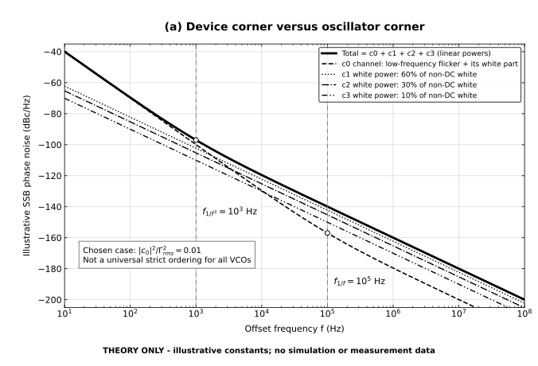
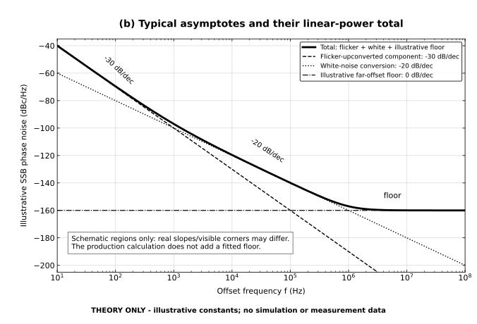

# Thermal noise theory and evidence

Thermal is an independent branch. The flicker sampler, harmonic coefficients and coherent sum retain their own meaning. The `flicker`, `thermal` and `both` options display the corresponding modeled mechanisms and their linear-power sum. Whole-VCO HBnoise includes other sources present in the simulation.

## 1. Coherent paths and independent bands

Let j identify an independent physical source, m an independent input band and k a periodic transfer path. Paths from the same input band preserve relative phase. For supported scalar, memoryless white noise with periodic PSD `S_j(t)`, write `a_j(t)=sqrt(S_j(t))`, its signed Fourier coefficients `a_j,n`, and the PM-projected transfer `H_j,k` at the specified offset.

```text
B_j,m = Σ_k H_j,k · a_j,(k−m)
P_j,m = |B_j,m|²
S_PM = Σ_j Σ_m P_j,m
```

B_j,m uses V/√Hz. P_j,m and S_PM use V²/Hz. Square each band's coherent amplitude, then sum the powers of independent j and m. For `h_j(t)=Σ_k H_j,k exp(−jkω0t)`, Parseval gives:

```text
Σ_m |B_j,m|² = (1/T) ∫_0^T |h_j(t)|² S_j(t) dt
```

Constant white PSD has only `a_j,0=sqrt(S_j)`, giving `S_j Σ_k |H_j,k|²`. A static colored source requires its own PSD at each `|m f0 + foffset|`.

The UI order N bounds both `|k|≤N` and `|m|≤N`. A wider HBnoise reference does not expand the budget. Wider internal Fourier support can contribute to retained bands, with excess recorded in `input_band_truncation.omitted_psd_V2_Hz`. The finite budget differs from full-period RMS when discarded power is nonzero. Results retain requested, input and transfer order. Changing N requires fresh evidence.

Folded HBnoise output PSD describes the output. For correlated paths use the full covariance `C_kl` with `Σ_kl H_k C_kl H_l*` or an equivalent independent-source decomposition. The math supports covariance input, while automated collection covers the documented independent scalar sources.

## 2. PM projection and PM-SSB units

The raw HBXF voltage response requires carrier-referenced projection. Use both output sidebands of the same input band and set `r=conj(V1)/|V1|` for peak carrier phasor V1.

```text
H_AM = (r H⁺ + conj(r) H⁻) / 2
H_PM = (r H⁺ − conj(r) H⁻) / (2j)
```

H⁺ refers to +f0+foffset and H⁻ refers to −f0+foffset. When reading the positive-frequency lower sideband, reverse the input index and conjugate. ISF applies:

```text
L_linear = 2 · S_PM / Vpeak²
L_dBc/Hz = 10 log10(L_linear)
```

S_PM is the independently verified PM voltage PSD convention for this tool. The projection factor, SSB factor and peak carrier definition form one convention. Use V/A with A²/Hz or V/V with V²/Hz. See [independent reference](THERMAL_REFERENCE.md) for the verified inductor label exception. Cadence distinguishes USB/LSB outputs, AM/PM components, and SSB/DSB options. Source PSD, PM transfer and carrier determine prediction; HBnoise provides the comparison. [Cadence noise and Direct Plot options](https://community.cadence.com/cadence_blogs_8/b/cic/posts/virtuoso-video-diary-performing-noise-simulation-in-spectre-rf-using-the-improved-pnoise-and-direct-plot-form-options)

## 3. Collection scope

| Scope | Supported evidence | Further qualification needed |
|---|---|---|
| Tools | Spectre 18.1 | Revalidate units and projection on other versions |
| MOS | BSIM3v3 and BSIM4 channel `id`, access resistor `rd/rs` at the native internal ports | Other device classes, correlated sources and unverified modes |
| Resistor | Native `rn` at the current-injection port | Nonlinear and time-varying sources |
| Inductor | Native series `rn`, V/V transfer, source PSD at actual input-band frequencies | Other multiport or correlated models |
| Device pair | Symmetric, independent devices with explicit `modeled_from` evidence | Independent sampling of a mismatched peer |

The standard budget is `gm_pair_and_lc_network`, with `passive_lc_branches_v2` and support for older `passive_only_lc_roots_v1` records. Branch ownership follows elaboration and includes explicit L/C branches whose descendants are supported R/L/C elements, including passive branches alongside active devices. Standalone resistors without proven LC ownership remain outside the budget. Loss resistors in a capacitor model may be included. Ideal capacitors contribute no source. Count each `(device, mechanism)` once. The supported scope excludes additional active devices, switch-array channels, custom Verilog-A, shot noise, and unqualified correlations. Legacy budgets with the retired expansion need a fresh run.

## 4. Sampling, truncation and missing data

- Generated and manual MOS fixtures share source selection, units and white-spectrum checks. The generated fixture maps `M_ISF_DC` and descendants to the selected occurrence.
- Use a zero ground-carrier reference for single-ended output. Missing or unsupported Spectre version evidence yields N/A before additional thermal simulation.
- Pair qualification uses master, effective geometry, source/body bias and cross-coupling. Where an isolation probe hides named connectivity, measured four-terminal voltages may provide a half-period cross-check with 1024 samples and maximum difference less than `1 µV + 0.1% × measured peak` per terminal. The private manifest and thermal budget retain evidence.
- Typical PSD sampling uses 24 independent phases plus the closing endpoint. Use `phase_sample_count` for actual coverage. Interpolating to 2049 points improves integration only.
- Fourier amplitude support uses `n=−32…32` on `sqrt(S(t))` and saves `amplitude_max_harmonic`. It does not establish that the independent samples resolve all 32 orders.
- H_k uses the measured two-sided overlap, capped by N and recorded as `transfer_max_harmonic`. With N=9 and amplitude support ±32 the convolution can reach ±41. The predicted budget still uses only `|m|≤N`.
- White-spectrum sampling checks foffset, f0 and the highest relevant input band. Its interpretation assumes the supported scalar, memoryless, quasi-static model.
- Require `0 < foffset < f0`, matching input and output bands, carrier and time origin. Use measured HB frequency coordinates. Old data can match the known six-significant-digit PSF representation.
- An invalid thermal budget yields thermal and combined N/A. Flicker remains independently available. An explicit `thermal_enabled=false` also applies to reanalysis and bypasses previous thermal evidence.
- `available` indicates the supported budget exists. Read numerical and model warnings alongside curve closure. CMI-2151 forward-biased junction warnings remain relevant after a zero-error solver exit.

Check convergence independently over phase samples, source-amplitude order and HBXF bandwidth.

## 5. Illustrative corner frequencies

The two figures use deterministic formulas and contain no fitted VCO data.



Consider a single source with `S_i(f)=S_w(1+f_device/f)`. Effective ISF mean `c0=〈Γ_eff〉` upconverts baseband flicker, while away from baseband the source is approximately white. Define `Γ_rms²=〈|Γ_eff|²〉`. Convert definitions if the Fourier constant is written as c0/2.

```text
L_c0(f)    = A η / f² · (1 + f_device/f)
L_other(f) = A (1−η) / f²
L_cj(f)    = w_j L_other(f), j=1,2,3; w_j≥0; Σ_j w_j=1
L_total(f) = A / f² · (1 + f_oscillator/f)
η = |c0|² / Γ_rms²
f_oscillator = η f_device
```

The device 1/f corner is f_device. The oscillator 1/f³ corner is f_oscillator. Frequency ratios are unchanged in rad/s. The mean-square inequality gives `0≤η≤1`. Non-DC ISF energy lowers the oscillator corner in this model. A constant Γ_eff permits equality, and zero mean removes this ideal term. Different noise envelopes, multiple sources, correlations and AM→PM paths can change the relationship.

Figure a uses η=0.01, device corner 100 kHz and oscillator corner 1 kHz. The c0 path includes flicker and its white component. Weights w=(0.6,0.3,0.1) show the other white input-band groups c1, c2 and c3. The bold line sums the four powers. The thin-line intersections need not equal the asymptotic corner. Here c0 is a period mean. Production Q_k are coherent contributions of the same flicker source. [Hajimiri–Lee theory](https://chic.caltech.edu/wp-content/uploads/2013/05/general.pdf) · [ISF decomposition](ISF_THEORY.md)

## 6. Illustrative −30, −20 and floor slopes



Figure b uses `L(f)=A f_corner/f³ + A/f² + L_floor`. The asymptotic slopes are −30, −20 and 0 dB/dec. At the intersection of two equal powers the sum is about 3 dB above either. Resonance, source mix, filtering or correlation can change the observed regions. The illustrative constant floor is absent from production calculations.

## 7. Reproduction and evidence

Additional switches, inverters and other active sources may appear in whole-VCO HBnoise. Their prediction requires device-specific source PSD over the actual terminal-voltage cycle. Static noise data for proven passive sources does not establish those PSDs. Unmodeled source values display as N/A and the calculation pie covers only modeled powers.

Independent BSIM4 `tnoimod=0/1` checks at two DC biases and three frequencies compared `|H_port|² × intrinsic PSD` with `noise.out` for id, rd, rs and native resistor ports. The reader uses actual TYPE names and units for `fn`, `total` and `fn.out`, including inline and replica names. Those checks qualify the measured scalar ports and conditions.

The command-line PSF reader prints complex numbers at about six significant digits. The `-f` flag raises real precision only. Subtracting nearly equal node responses can amplify roundoff. Independent port checks used double-precision Ocean exports, while production interpretation must retain the CLI limitation.

```bash
python3 scripts/render_thermal_theory.py
python3 scripts/render_thermal_theory.py --check
```

Matplotlib is required to regenerate the deterministic SVGs. `--check` compares generated bytes without changing the files. Version and font changes can change bytes. Keep illustrative formulas, independent no-PDK reference checks, and actual per-point VCO evidence as distinct records.

The thermal implementation is in `isf_tool/thermal.py`, `isf_tool/core/noise_sources.py`, `thermal_ports.py`, `thermal_execution.py`, and `thermal_budget.py`. Flicker retains its separate implementation in `isf_tool/calculation.py` and its engine path.

## Complementary-core device scope

Each selected complementary device uses its own phase-resolved fixture PSD and
transfer from its physical intrinsic source port. This budget includes supported
thermal mechanisms of that MOS and any symmetry-qualified peer. The closure
comparison uses the selected intrinsic device's channel `id` contribution.
The complementary result sums the independent per-device budgets in power.
