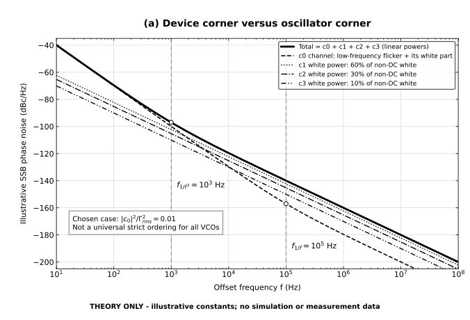
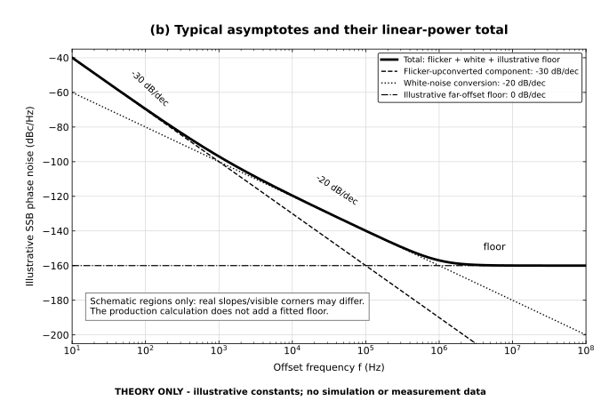

# Thermal 支路：理论、实现与证据边界

热噪声是与原 flicker 计算并行的独立支路。原 flicker 的采样、谐波系数和相干求和规则不因本支路改变。UI 的 `flicker`、`thermal`、`both` 分别选择已建模闪烁噪声、已建模热噪声、两者的**线性功率合计**；都不自动等于整个 VCO 的全部噪声。

当前计算范围限于 gm 器件对的 flicker、thermal 和支持的 LC thermal。实验性的附加阵列／子电路扩展已撤回，不再将额外模块放入共享噪声 TB 做器件匹配。原噪声 TB 的恢复记录、备份及新验证单独保留；原 VCO、历史结果和 flicker 算法不因回退而修改。日常采样和追加分析仍只写本次任务目录。

## 1. 相干求和与功率求和不是二选一

用 `j` 标记物理上独立的噪声源，`m` 标记该源的独立输入频带，`k` 标记周期系统传递路径。一个输入频带可以沿多条周期调制路径到达同一输出；这些路径来自同一随机量，必须保留相位并先相干合成。

对支持的标量、无记忆、周期调制白噪声模型，令 `S_j(t)` 为源的周期 PSD，`a_j(t)=sqrt(S_j(t))`，`a_j,n` 为其完整带符号 Fourier 系数，`H_j,k` 为指定输出频偏处的 **PM 投影传递量**：

```text
B_j,m = Σ_k H_j,k · a_j,(k−m)
P_j,m = |B_j,m|²
S_PM = Σ_j Σ_m P_j,m
```

`B_j,m` 的单位是 V/√Hz，`P_j,m` 和 `S_PM` 为 V²/Hz。第一行是同源同输入频带内的相干求和；最后一行才是独立频带、独立物理源的功率求和。不能将第一行替换为 `Σ_k |H_j,k a_j,(k−m)|²`，也不能把不同独立 `m` 的复振幅相加。

定义 `h_j(t)=Σ_k H_j,k exp(−jkω0t)`，则同一假设下 Parseval 给出：

```text
Σ_m |B_j,m|² = (1/T) ∫_0^T |h_j(t)|² S_j(t) dt
```

这也是时间加权积分的交叉核对形式。常量白谱特例只有 `a_j,0=sqrt(S_j)`，退化成 `S_j Σ_k |H_j,k|²`。对静态但有色的无源源谱，逐输入频带读取 `S_j(|m f0 + foffset|)`，不能把一个频点的 PSD 用遍全部频带。

UI 计算阶数 `N` 现在同时限定传递阶数 `|k|≤N` 与独立输入频带 `|m|≤N`，不会
被更大的 HBNoise 参考 sideband 设置扩大。周期噪声幅值的 Fourier 系数仍可保留
较宽内部支撑，但卷积后超出 `|m|≤N` 的功率不进入预测，记录在
`input_band_truncation.omitted_psd_V2_Hz`。因此这是显式**有限频带预算**，不能
把裁掉尾部的和宣称为完整时间域 RMS。降低 N 可能降低预测，应检查阶数收敛。
新结果保存 requested/transfer/input 三个阶数；旧结果只显示其实际已保存范围。
修改 N 后应重仿；仅重新分析不会把旧 thermal 预算冒充为新 N 的结果。

**不成立的捷径：**已折叠的 HBNoise 输出 PSD 不是某个独立输入频带的源 PSD，不能再乘 `|H_k|²` 二次折叠；普通端口噪声 PSD 也不足以恢复 cyclic cross-spectrum。相关栅漏噪声或多端口相关源需要完整协方差 `C_kl`，用 `Σ_kl H_k C_kl H_l*` 或等价独立源分解。数学模块有协方差入口，但当前自动采集支路不宣称已支持这些相关源。

## 2. PM 投影、SSB 与常数

原始 HBXF 是输出电压传递，不天然等于 PM。必须对**同一输入频带**的正、负载波输出响应做投影。令载波峰值复相量为 `V1`，`r=conj(V1)/|V1|`：

```text
H_AM = (r H⁺ + conj(r) H⁻) / 2
H_PM = (r H⁺ − conj(r) H⁻) / (2j)
```

`H⁺` 指 `+f0+foffset`，`H⁻` 指 `−f0+foffset`；由正频率下边带读取时必须匹配反向输入索引并取共轭。不能用两个任意幅值的平方和代替上述投影。

热支路复用原有函数的 PM-SSB 归一化，不调整旧计算：

```text
L_linear = 2 · S_PM / Vpeak²
L_dBc/Hz = 10 log10(L_linear)
```

这里 `S_PM` 是本工具已独立验证过约定的 PM 电压谱，**不是可以直接代入另一种定义的 S_phi**。投影中的 `1/2`、以上 `2` 和载波峰值定义作为一个整体已由无 PDK 白噪声参考验算；不可额外补乘 SSB/DSB 因子。阻抗端口同时检查：电流源 PSD（A²/Hz）配 V/A；串联电压源 PSD（V²/Hz）配 V/V。原生电感的已验证标签例外见 [独立参考](THERMAL_REFERENCE.md)。

Cadence 官方明确区分 USB/LSB 总电压噪声与 AM/PM 分量，并为 AM/PM 提供 SSB、DSB 显示选项；比较时必须匹配这些口径。它说明的是分析/显示语义，**不是本工具数值因子的验收替代品**。[Cadence：Pnoise/Hbnoise 与 Direct Plot 选项](https://community.cadence.com/cadence_blogs_8/b/cic/posts/virtuoso-video-diary-performing-noise-simulation-in-spectre-rf-using-the-improved-pnoise-and-direct-plot-form-options)

没有从 VCO 总 HBNoise 或器件输出贡献拟合常数、比例、符号或增益。源谱、PM 传递量和载波产生预测；主 VCO HBNoise 只提供独立比较曲线。示意图中的常量也不会进入生产计算。

## 3. 当前自动采集究竟支持什么

| 范围 | 已支持内容 | 不能据此推断的内容 |
|---|---|---|
| 工具约定 | 已验证的 Spectre 18.1 系列；参考验算使用该系列的一个发行版 | 其他版本无需验收即可复用单位/投影约定 |
| MOS | 原生 BSIM3v3/BSIM4 的 `id` 通道热噪声及 `rd/rs` 访问电阻热噪声；按实际内部端口注入 | 把 diode 的 `id` 散粒噪声或任意同名字段当成 MOS thermal；推断任意 BSIM4 模式/相关源均已支持 |
| 电阻 | 已解析原生 resistor 的 `rn`，节点电流端口 | 任意非线性、时变电阻都可用静态源谱 |
| 电感 | 已验证原生 inductor 的串联 `rn`，V/V 支路传递；按实际输入频率读取源谱 | 用并联电流端口替代串联电压端口；未知多端口互谱 |
| 器件对 | 用户采用的对称、独立双器件模型；对端标明 `modeled_from` | 对端已独立做完全部瞬时偏置仿真，或任何失配电路均满足对称假设 |

工况内的节点、端口、模型与器件结构从任务网表/终端证据读取，不把某台机器上的固定网名当成通用电路。当前预算标识为 `gm_pair_and_lc_network`，并保留 `passive_scope=passive_only_lc_roots_v1`。无源来源按真实 primitive 分组：根层 L/C 器件或由 R/L/C 等支持的纯被动器件组成、且包含 L/C 的根子电路可纳入；含 MOS、二极管或未知器件的模块不按 LC 处理，其内部电阻也不混入预算。理想电容不产生额外热噪声；电容模型里的受支持损耗电阻可以计入。

同一 `(device, mechanism)` 只计入一次。主 gm 对沿用既有对称独立模型；额外 MOS、开关阵列、自定义 Verilog-A、散粒噪声及未支持相关源不自动补入预测。总 HBNoise 参考保留真实完整电路，因此参考中仍可出现这些来源；预测和总仿真不一定相等。旧扩展预算或没有新范围证据的旧预算要求重新运行，不能仅换标签后当成 gm + LC 结果。

## 4. 采样、截断与 N/A

- 既有主 MOS 支路使用 VCO 波形驱动的准静态源谱：目前常用 **24 个真实相位样本**，再增加周期闭合端点。以结果 `phase_sample_count` 为准。
- 对源谱样本插值到 2049 点只改善数值积分，**不会增加独立仿真相位样本的数量**。
- 对 `sqrt(S(t))` 取 `n=−32…32` 的振幅 Fourier 支持。该截断记录在 `amplitude_max_harmonic`；不是宣称原采样已解析 32 阶细节。
- `H_k` 只用上下边带共同存在的实测 HBXF 范围，并受用户阶数 N 限制；实际以 `transfer_max_harmonic` 为准。振幅卷积可形成比传递范围更宽的候选输入频带，例如 N=9、振幅支持 ±32 时可到 ±41；**真正纳入预测的仍只有 `|m|≤N`**，其余只记录为截断功率。
- 白谱检查包含 `foffset`、`f0` 及最高卷积输入频带的抽查；这些抽查不等于证明任意连续频率都完全白。此结论仍依赖所支持源的标量、无记忆、准静态模型。
- PM 投影要求 `0 < foffset < f0`，源频带、上下输出、载波和周期时间原点必须一致。
- 基波从 HB 实测频率坐标读取，避免头部低精度显示影响边带定位。合并旧结果时仅兼容相同基波或其已知 PSF 六位有效数字序列化值，不用宽松容差吞掉真实频率差异。
- 若主 thermal 预算本身缺少必要源、端口、频带或有效证据，thermal 为 `unavailable/N/A`；两者合计也为 N/A，**不是把 thermal 当零后只显示 flicker**。仍可单独查看已有 flicker。
- 专家设置显式 `thermal_enabled=false` 时，重新分析也返回 unavailable，不会读取同目录残留的旧 thermal 预算。
- `available` 表示可以形成该模型的预算，不等于数值质量通过，更不等于签核。应查看 thermal 自身的数值告警、完整性和限制，不能只看曲线接近。
- CMI-2151 所述缺失 bulk-drain/source 结二极管正向偏置等模型告警仍记录在质量证据中；Spectre 以 0 errors 结束不能消除这类告警，也不会因此自动修补 PDK 或原 TB。

相位样本数、振幅截断和 HBXF 带宽属于独立收敛问题，应分别增加并观察变化；本说明不把当前默认值写成普适精度保证。

## 5. 理论示意 a：为什么常见振荡器 corner 比器件 corner 低

以下两幅图完全由确定性公式生成，**不是 VCO 的仿真或测量结果**，也不是对当前运行结果的拟合。



在单源简化模型中，设器件噪声 `S_i(f)=S_w(1+f_device/f)`，低频 flicker 主要经有效 ISF 的 DC 分量上变频，远离 DC 的源噪声近似白。这里直接定义 `c0=〈Γ_eff〉` 为周期均值、`Γ_rms²=〈|Γ_eff|²〉`；若文献将 Fourier 常数项写成 `c0/2`，必须先换算定义。

对同一噪声包络、同一归一化的单源模型：

```text
L_c0(f)    = A η / f² · (1 + f_device/f)
L_other(f) = A (1−η) / f²
L_cj(f)    = w_j L_other(f), j=1,2,3; w_j≥0; Σ_j w_j=1
L_total(f) = A / f² · (1 + f_oscillator/f)
η = |c0|² / Γ_rms²
f_oscillator = η f_device
```

因此图中两个 corner 分别是器件 `f_(1/f)=f_device` 和振荡器 `f_(1/f³)=f_oscillator`，**不是两个 PVT corner**。用角频率表示时 `ω=2πf`，比值不变。

这个受限模型由均值平方不大于均方得到 `0≤η≤1`；当有效 ISF 有非 DC 能量时通常严格小于 1，因此常见振荡器 corner 更低。若 Γ_eff 为常量，两者可相等；若均值严格为零，理想模型的这一路 1/f³ 项消失。多种源、不同 flicker/white 包络、不同偏置下定义的器件 corner、相关噪声或额外 AM→PM 路径，会改变上述简化关系。**不能声称任意 VCO 的 ω_(1/f³) 都严格小于某个指定器件的 ω_(1/f)。**

图 a 取 `η=0.01`、器件 corner `100 kHz`、振荡器 corner `1 kHz`。虚线 c0 通道包含低频 flicker 及其自身 white 部分；另外分别画出 `c1、c2、c3` 三条下降的 white 功率线，以固定非负权重 `w=(0.6,0.3,0.1)` 分配非 DC white 功率，表示简化模型的不同独立输入频带组。粗实线是 `L_c0+L_c1+L_c2+L_c3` 的**线性功率和**。这里权重是理论示意参数，不是从 VCO 结果提取或拟合；细线交点也不必精确等于整体渐近 corner。

这里的 c0 是简化理论中的**有效 ISF 均值**，不是命令 UI 只取第 `k=0` 行。现有 flicker 的各 `Q_k` 仍按已验证流程复数相干相加，不能把图 a 的独立 white 功率分解套到这些 `Q_k` 上，也不能把它们画成可相加的功率堆叠。

理论出处为 Hajimiri 与 Lee 的周期时变 ISF 模型及其低频噪声上变频分析：[A General Theory of Phase Noise in Electrical Oscillators，JSSC 1998，作者 PDF](https://chic.caltech.edu/wp-content/uploads/2013/05/general.pdf)。该文用于解释理论关系，不用于直接搬用 Fourier 常数项、单/双边谱或载波幅值的数值约定；本工具常数仍以 [独立参考验算](THERMAL_REFERENCE.md) 为依据。

## 6. 理论示意 b：−30 / −20 / floor



图 b 采用 `L(f)=A f_corner/f³ + A/f² + L_floor`：近端 flicker 上变频项常呈 −30 dB/dec，中间白噪声相位转换项常呈 −20 dB/dec，示意的远端 floor 为 0 dB/dec。转折是平滑的；等功率两项相加在交点比任一单项高约 3 dB，不能在 dB 轴直接相加。

这些是典型渐近区域，不保证每个 VCO、每段频偏都依次出现。有限数据、不同源、谐振/滤波、相关性或噪声底可能隐藏或改变区域。图中的 floor 是讲解用固定常量，**生产热支路不会为了凑出这条线而增加经验 floor 或拟合项**。

## 7. 重现、证据分层与代码入口

### 额外有源器件为何会显示 N/A

HBNoise 的全电路参考会列出目标 gm 对之外的开关、反相器等器件；这不表示它们
已经进入 ISF 计算预算。静态 VCO `noise` 的 intrinsic 源谱可用于当前已支持的
原生无源源，但不能无条件推广到周期偏置明显变化的额外 MOS。
这些器件需要真实 model/geometry 与各自 VGS/VDS/VBS 的周期源谱采集，不能复制
目标 gm MOS 的源谱，也不能用 HBNoise 的输出贡献反推预测输入以“补齐”曲线。
当前不提供附加阵列的计算入口，相关来源保留 N/A；计算饼图只统计已计算功率，不能把尚未建模的项目当成零。

### BSIM4 与数值读取边界

本机已用实际 BSIM4 `tnoimod=0/1` 模型，在两个 DC 偏置、三个频点逐源核对
`|H端口|² × intrinsic PSD` 与原生 `noise.out`，验证 `id/rd/rs` 及所测模型内的
原生电阻端口。这证明对应标量端口，不证明任意模型模式或周期准静态近似的精度。
`fn`、`total` 和 `fn.out` 按真实 TYPE 字段名/单位读取，避免把 BSIM4 的零值
衬底电阻字段误读成 flicker；inline 原始器件与普通动态副本采用各自的原生名称。

当前命令行 PSF 导出对复数仍只保留六位有效数字；`-f` 提高实数精度不会同时
提高复数精度。相近节点传递量相减时，小噪声支路会有较大的相对舍入误差。
上述独立端口验收使用 Ocean 原生双精度导出排除了此误差；生产路径的这个限制
仍须在逐源偏差分析中说明，不能通过放宽误差阈值宣称已经修复。

### 复现入口

```bash
python3 scripts/render_thermal_theory.py
python3 scripts/render_thermal_theory.py --check
```

绘图需已有 Matplotlib；不会安装依赖、启动桌面或触发 EDA。脚本只生成 `docs/assets/thermal_theory_corners.svg` 和 `thermal_theory_slopes.svg`，固定公式、线型及 SVG 元数据，并输出参数、SHA-256 与算术检查。`--check` 不改图，只核对复现字节；绘图库/字体版本改变时 SVG 字节可改变，不代表物理公式改变。

证据必须分开保存和解释：

1. **本页理论示意**：说明模型和求和规则，没有实测输入。
2. **[无 PDK 独立参考](THERMAL_REFERENCE.md)**：已完成的独立 Spectre 小电路，验证投影/单位/功率约定。
3. **实际 VCO 每工况、每频偏结果**：独立 PSF、源系数、截断与质量记录，才用于判断该 VCO 的数值可信度。不得以示意图代替验证曲线。

实现入口：`isf_tool/thermal.py`（独立数学）、`isf_tool/core/noise_sources.py`（保留类型/单位的解析）、`thermal_ports.py`（真实端口）、`thermal_execution.py`（独立热支路采集）、`thermal_budget.py`（证据与显示量校验）。原 flicker 数学仍在 `isf_tool/calculation.py` 与既有引擎路径，不由绘图脚本修改。
